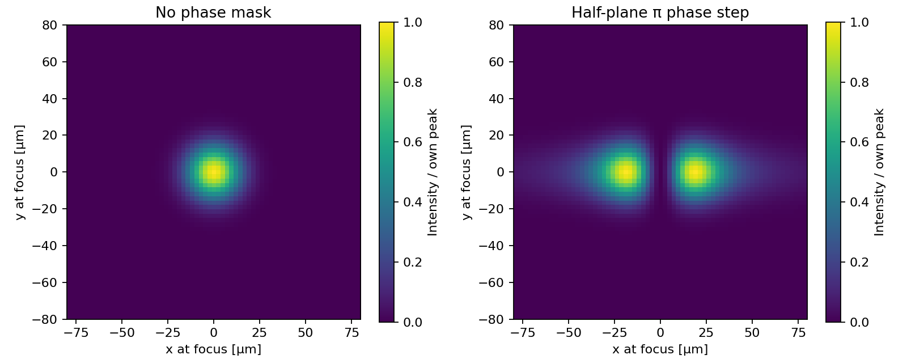

# Gaussian beam with a pi phase step

A Fourier-optics calculation of a Gaussian beam at a lens focus, with and
without a half-plane pi phase step. Flipping the field sign on one half of
the pupil suppresses the central focal intensity and produces two lobes.



Each focal intensity is normalized to its own peak. The phase mask has unit
magnitude and preserves integrated power.

## Run

Use Python 3.10 or later. From the repository root:

```bash
python -m venv .venv
source .venv/bin/activate
python -m pip install -r requirements.txt
python src/pi_phase_kick.py
```

In Windows PowerShell, activate with `.venv\Scripts\Activate.ps1`.

The script opens three figures: pupil amplitude and phase multiplier, focal
intensities, and a line cut through the focal center. To save them instead:

```bash
python src/pi_phase_kick.py --output results/phase_step
```

This writes `pupil.png`, `focus.png`, and `line_cut.png`.

## Parameters and model

Edit the constants at the top of
[src/pi_phase_kick.py](src/pi_phase_kick.py) to change the calculation.

| Parameter | Default |
| --- | ---: |
| Vacuum wavelength | 632.8 nm |
| Focal length | 150 mm |
| Gaussian 1/e field radius at the lens | 1.5 mm |
| Grid | 1024 × 1024 |
| Lens-plane span | 40 mm |

The pupil field is `exp(-(x² + y²) / w²)`. The mask multiplies it by −1
for `x < 0` and +1 for `x >= 0`. A weak edge taper damps the field near
the grid boundaries.

The focal field is the centered 2D FFT of the pupil, multiplied by
`dx² / (i λ f)`. Focal coordinates follow `x_focus = λ f fx`, where
`fx` is spatial frequency in cycles per meter. All internal lengths are
in meters.

The calculation uses scalar Fraunhofer propagation through an ideal lens to
its focal plane. Assigning the `x = 0` column to the positive half of the
mask leaves a small central residual on the sampled grid.

## Checks

```bash
python -m unittest discover -s tests -v
```

The checks compare the unmasked focus with the analytic Gaussian profile,
verify Fourier-transform power scaling, and confirm power conservation and
central suppression with the phase step.
